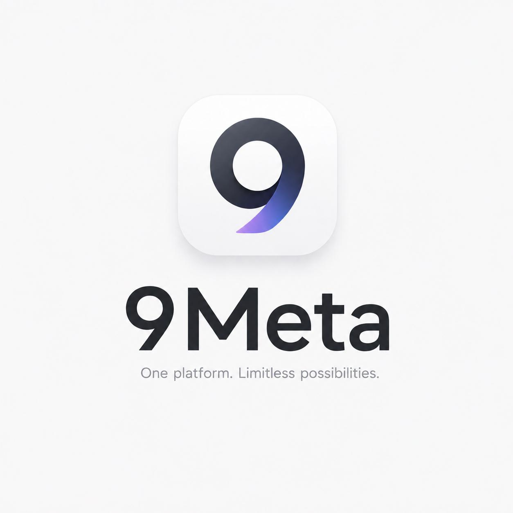

# MessHub

<p align="center">
  
</p>

<p align="center">
  <strong>MessHub</strong> — Desktop workspace for managing multiple messaging accounts in one place.
</p>

<p align="center">
  
  
  
  
</p>

---

## Overview

**MessHub** is a cross-platform desktop application built with **Electron + Chromium** for managing multiple messaging and communication accounts in one place.

Instead of opening multiple browser windows, MessHub provides a unified desktop workspace where each account can run inside an isolated profile/session.

The application currently provides isolated platform sessions, workspaces,
quick replies, app locking, download management, and desktop utilities.

---

## Supported Platforms

MessHub supports web-based communication platforms including:

- Zalo
- Messenger
- Facebook / Fanpage
- Telegram
- WhatsApp
- Microsoft Teams
- Gmail
- TikTok

---

# Features

## Multi-Account Management

Manage multiple accounts from a single desktop application.

- Multiple independent profiles
- Isolated browser sessions
- Separate Chromium partitions
- Custom account name
- Custom avatar
- Platform selection
- Proxy configuration
- Fast account switching
- Unread message indicators

Each profile can maintain its own login session without interfering with other profiles.

---

## Workspace

MessHub supports isolated workspaces for different projects, teams or account groups.

Each workspace stores its own account profiles and quick replies.

Example:

```text
Workspace: Sales Team
├── Zalo Account 01
├── Zalo Account 02
├── Messenger Account
└── Quick Replies

Workspace: Personal
├── Zalo Personal
├── Telegram
└── Gmail
```

The desktop app runs locally and does not require a backend service.

## Project structure

```text
src/
├── main/                    Electron process and application lifecycle
│   ├── index.js
│   └── storage/              Local settings and workspace persistence
│       ├── json-store.js
│       └── workspace-store.js
├── preload/                 Isolated bridge and messaging-site helpers
│   ├── index.js
│   └── page-injection.js
└── renderer/                Desktop interface
    ├── index.html
    ├── renderer.js
    └── styles/
        ├── app.css
        └── platform-overrides.css
assets/
└── icons/                   Application and Windows installer icons
docs/                        Project website
scripts/
└── clean-build-output.js    Remove temporary Linux build files after packaging
```

The Electron application entry point is `src/main/index.js`. User settings,
workspaces, and browser session partitions retain their existing locations so
updates preserve account sessions and local data.

`npm run build` places the `MessHub Client` AppImage in the project root. The
post-build cleanup removes the temporary `linux-unpacked` directory and builder
diagnostic files while keeping the AppImage and update metadata.
